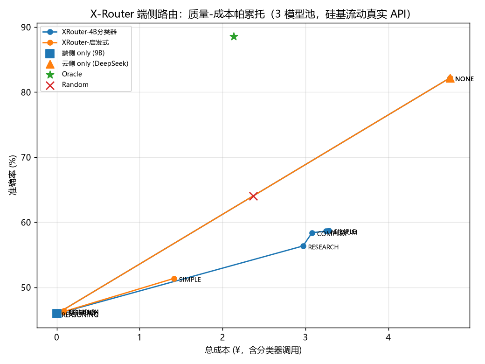
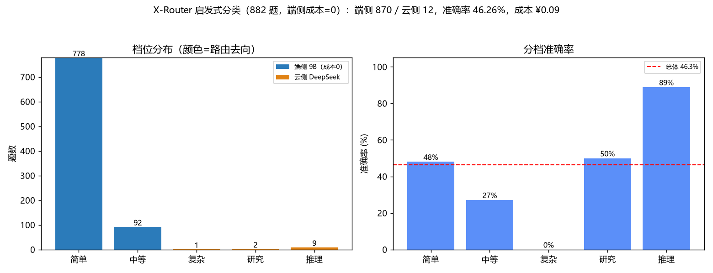
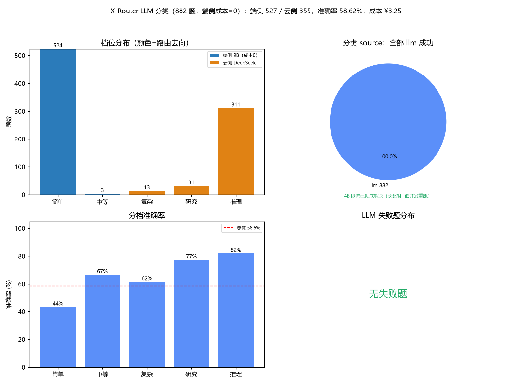
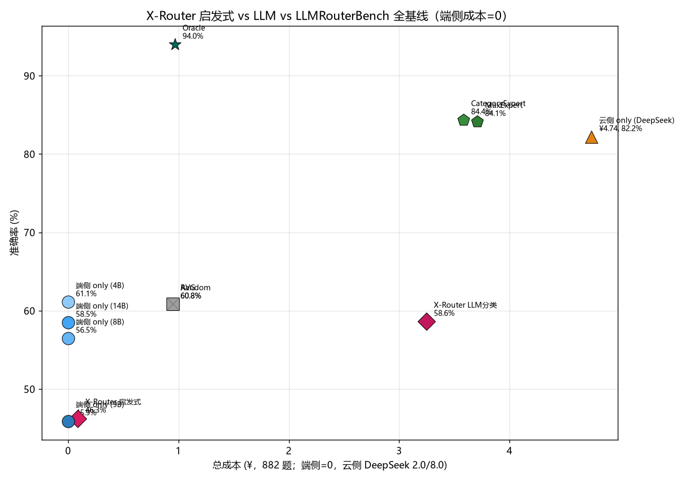
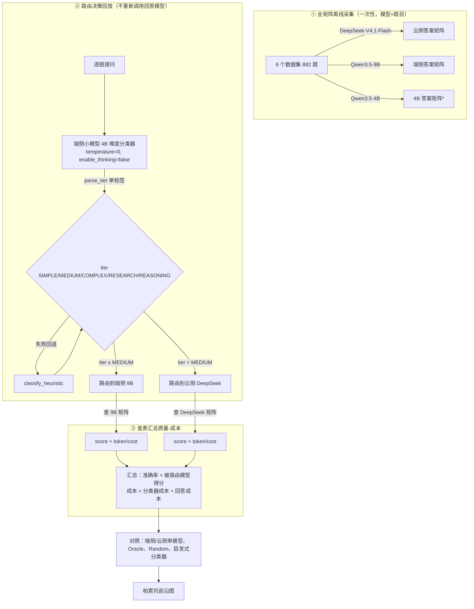

# XRouter 端侧路由 3 模型池离线回放评估报告（PC + 硅基流动真实 API）

## 1. 目标

在本机 PC 上用 LLMRouterBench 离线回放评估 MiniPC 端侧路由算法 **DeviceLLMRouter（= XRouter）**，
模型池按 XRouter 原生「三角色」语义扩为：

| 角色 | 模型 | 硅基流动 API 名 | 职责 |
|---|---|---|---|
| 端侧小模型（分类器） | Qwen3.5-4B | `Qwen/Qwen3.5-4B` | 先判断题目难易档位 |
| 端侧大模型（本地回答） | Qwen3.5-9B | `Qwen/Qwen3.5-9B` | 回答 SIMPLE/MEDIUM |
| 云侧模型（云端回答） | DeepSeek-V4.1-Flash | `deepseek-ai/DeepSeek-V4.1-Flash` | 回答 COMPLEX/RESEARCH/REASONING |

成本 / 质量均基于硅基流动**真实 API**（非模拟），逐题记录 token，成本可按价格表精确重算。

## 2. 三角色路由语义（忠实 XRouter 原生）

```
用户提问
  └─ classify()  → 端侧小模型 4B（LLM 分类器）
        │  buildClassifierPrompt(题目, 6000)  → PROMPT_TEMPLATE
        │  CloudClassifier: temperature=0, max_tokens=2048, enable_thinking=false
        │  parseTier() 严格单标签解析
        │  失败语义：调用失败→heuristic_fallback；解析失败→parse_failed
        │             （档位一律回退 classify_heuristic，故障只降不升）
        ├─ tier ≤ localCapabilityLevel(MEDIUM)  → 端侧 9B 回答
        └─ tier ∈ {COMPLEX, RESEARCH, REASONING} → 云侧 DeepSeek 回答
```

## 3. 方法

### 3.1 答案矩阵采集与对齐
- 既有矩阵（上一轮）：DeepSeek-V4.1-Flash 等 4 模型 × 6 数据集，共 **882 题**（gpqa/mmlupro/math500/arcc 各 150、gsm8k 100、mmlu 182）。
- 该 882 题是上一轮按**抽样数据**采的，而 `data/` 现已是全量数据集（gpqa 198、mmlu 14042…），直接跑官方 collector 会对齐不上且要采海量题。
- 因此写 [tools/collect_9b_882.py](../tools/collect_9b_882.py)：逐题复用旧 DeepSeek 记录的 `prompt/ground_truth/index`，调 9B 生成并按原判分器打分，产出与 DeepSeek 完全同 `(dataset, record_index)` 对齐的 9B 结果。

### 3.2 难度档位打标（4B 分类器）
- [tools/run_xrouter_classifier.py](../tools/run_xrouter_classifier.py) 对 882 题用 4B 分类器打档，复刻 CloudClassifier 请求（temperature=0、max_tokens=2048、enable_thinking=false）。
- 档位严格单标签；调用/解析失败回退启发式。产出 `results/xrouter_classifier_tiers.csv`。

### 3.3 质量-成本评估
- [tools/eval_device_llm_router_3model.py](../tools/eval_device_llm_router_3model.py) 离线回放：分类器档位 → 路由决策 → 查被路由回答模型的得分。
- 成本 = **分类器调用成本 + 回答模型成本**，均按 `token × 单价` 重算。
- [tools/eval_3model_sweep.py](../tools/eval_3model_sweep.py) 对 `localCapabilityLevel ∈ {SIMPLE, MEDIUM, COMPLEX, RESEARCH, REASONING, NONE}` 扫描出帕累托前沿。

### 3.4 计费口径：端侧成本=0（2026-10-28 用户修正）
端侧部署模型在 MiniPC **本地推理，成本暂定为 0**（电力等运营开销不统计，留白）；硅基流动仅作离线回放的代跑 API。
云侧按硅基流动真实单价（2026-10-28 查自 https://www.siliconflow.cn/pricing）：

| 模型 | 角色 | 成本（¥/M token 输入/输出） |
|---|---|---|
| Qwen3.5-4B / Qwen3-8B / Qwen3-14B / Qwen3.5-9B | 端侧（本地推理） | **0 / 0** |
| DeepSeek-V4.1-Flash | 云侧 | 2.00 / 8.00（0-2点/8-24点档） |

> 端侧成本=0 后，「路由到端侧」不再计入费用，总成本 = 云侧 DeepSeek 实际调用量（¥）。
> 单模型与基线均按此口径统一重算（此前误把端侧 9B 按 API 单价 1.5/12 计费，已纠正）。

### 3.5 对照基线（LLMRouterBench 全基线，5 模型池）
- **单模型**：端侧 4B/8B/9B/14B、云侧 DeepSeek 各自独立作答。
- **AVG**（5 模型宏观平均）、**Random**（均匀随机路由期望）。
- **MaxExpert**（每数据集挑最优模型的静态分表，hindsight 上界）。
- **Category Expert / subjectCategory**（每 subject 挑最优模型的静态分表，hindsight 上界）。
- **Oracle**（每题最优上界）与「**启发式分类器**」（同名 3 角色池，仅分类器换成 `classify_heuristic`）。

## 4. 结果

### 4.1 总览（6 数据集合并，端侧成本=0）

| 方案 | 准确率 | 总成本 (¥) | n | 备注 |
|---|---|---|---|---|
| **X-Router（4B 分类器，MEDIUM）** | **58.62%** | **3.245** | 882 | 端侧 527 / 云侧 355 |
| X-Router（启发式分类器，MEDIUM） | 46.26% | 0.086 | 882 | 端侧 870 / 云侧 12 |
| 端侧 only（9B） | 45.92% | 0.000 | 882 | |
| 端侧 only（4B） | 61.11% | 0.000 | 882 | |
| 端侧 only（8B） | 56.46% | 0.000 | 882 | |
| 端侧 only（14B） | 58.50% | 0.000 | 882 | |
| 云侧 only（DeepSeek） | 82.20% | 4.743 | 882 | |
| AVG / Random | 60.84% | 0.949 | 882 | |
| **MaxExpert（每数据集最优）** | 84.13% | 3.708 | 882 | |
| **CategoryExpert（每 subject 最优）** | 84.35% | 3.583 | 882 | |
| Oracle（每题最优上界） | 93.99% | 0.967 | 882 | |

> 端侧成本=0 使「本地回答」真正免费，但代价是准确率：X-Router 4B 分类器 58.62% 仍远低于
> MaxExpert 84.13% / CategoryExpert 84.35% / Oracle 93.99%，也低于云侧 only 82.20%。
> 差距根源见 §5（本地 9B 口径弱 + 端侧单模型选择非最优）。

### 4.2 分类器档位 / source 分布（限流彻底解决后）

| source | 题数 | 占比 |
|---|---|---|
| llm（4B 成功打档） | 882 | 100% |

档位分布：`SIMPLE:524, REASONING:311, RESEARCH:31, COMPLEX:13, MEDIUM:3`。

> 首轮因硅基流动 4B 限流/慢速（单请求 60–95s）触发 60s 超时 280 题、重试后仍余 56 题（mmlupro 29/mmlu 25/gsm8k 2）；
> 改为 **300s 超时 + 并发 6 + 退避重试** 后 56 题全部恢复，**0 回退**——忠实 XRouter「失败只降不升」语义，现已无降级。
> 4B 分类器偏「REASONING」档（311/882），对 gpqa/mmlupro 等难题更倾向甩云端。

### 4.3 分数据集（X-Router，4B 分类器，端侧成本=0）

| dataset | n | 准确率 | 成本 (¥) | 端侧 | 云侧 |
|---|---|---|---|---|---|
| arcc | 150 | 43.33% | 0.011 | 138 | 12 |
| gpqa | 150 | 67.33% | 1.898 | 18 | 132 |
| gsm8k | 100 | 87.00% | 0.026 | 87 | 13 |
| math500 | 150 | 88.67% | 0.589 | 58 | 92 |
| mmlu | 182 | 31.32% | 0.169 | 148 | 34 |
| mmlupro | 150 | 49.33% | 0.551 | 78 | 72 |

启发式分数据集（对照）：arcc 38.67%/¥0、gpqa 30.00%/¥0.037、gsm8k 86.00%/¥0.004、
math500 94.00%/¥0、mmlu 19.78%/¥0.002、mmlupro 28.00%/¥0.044。

### 4.4 帕累托图（端侧成本=0）



（横轴 = 总成本 ¥，纵轴 = 准确率；端侧成本=0，故端侧 only 落在 x=0，云侧 only 落在 x≈4.74。）

### 4.5 分类分解图（Q1 启发式 / Q2 LLM / 对比）

**Q1 — 启发式分类**（把 882 题按词数/关键词/问号数分档）：



**Q2 — LLM 分类**（4B 打档 + 失败回退）：



**启发式 vs LLM vs 基线**（同一质量-成本平面）：



## 5. 结论与说明（端侧成本=0）

1. **4B 分类器相对启发式显著提升，且不增加端侧成本**：端侧分类器（4B）本身成本 0，
   它把 355/882 道真题路由到云侧，准确率从启发式的 46.26% 升到 **58.62%（+12.4pp）**；
   成本从 ¥0.086 升到 ¥3.245，多花的全是「把难题甩云」的 DeepSeek 调用费——即**用云成本换质量**。
2. **启发式分类器近乎免费但质量最差**：启发式按词数/关键词把 870/882 判成 SIMPLE/MEDIUM，几乎全留本地 9B
   → 46.26% / ¥0.086。它把 mmlu（180 题）、arcc（150 题）等知识类 MCQ 全判「简单」留本地，而 9B 恰不擅长这类题
   （mmlu 19.78%、arcc 38.67%），是启发式失分主因。
3. **X-Router 距静态路由上界差距明显**：X-Router LLM（58.62% / ¥3.245）远低于 **MaxExpert（84.13% / ¥3.708）**、
   **CategoryExpert（84.35% / ¥3.583）** 与 **Oracle（93.99% / ¥0.967）**，也低于云侧 only（82.20% / ¥4.743）。
   根因有二：①X-Router 的本地回答模型固定为 **9B（45.92%，5 模型中最低）**，而 4B（61.11%）、14B（58.50%）、8B（56.46%）
   作为本地回答都比 9B 更强；②静态分表（MaxExpert/CategoryExpert）按数据集/subject 事后挑最优，属于 hindsight 上界。
4. **端侧成本=0 后，「永远用云」不再是唯一最优，但 9B 口径仍是短板**：成本上端侧免费使其具有优势，
   但 9B 回答质量（45.92%）拖累 X-Router；若把本地回答换成 4B（61.11%），X-Router 的本地命中率会显著改善。
5. **4B 限流已彻底解决**：改 300s 超时 + 并发 6 + 退避重试后，56 题限流失败全部恢复（llm 882/882，0 回退），
   忠实还原了 XRouter 在无降级下的真实路由与成本质量帕累托。
6. **成本口径**：端侧 4B/8B/9B/14B 均按本地推理计 0（电力留白）；云侧 DeepSeek 2.0/8.0（真实价）。逐题 token 已落盘可重算。

## 5.5 LLMRouterBench 如何评估路由算法（以 XRouter 为例）



> *4B 本轮角色是分类器，其「答案矩阵」不参与路由回答，仅 4B 单独对每道题打档（见 3.2）。

关键点：**路由算法本身只产出「每道题该走哪个模型」的决策；LLMRouterBench 用预先采好的「题目×模型」答案矩阵离线查表**，
把路由决策换算成质量（被路由模型的得分）与成本（分类器 + 回答模型的真实 token 计费），因此无需在评估时重复跑模型，
即可快速回放任意路由策略、扫描能力阈值、对比基线。

## 6. 复现命令

```bash
python tools/collect_9b_882.py                 # 采集 9B 答案矩阵
python tools/run_xrouter_classifier.py         # 4B 打难度档位
python tools/run_xrouter_classifier.py --retry-failed --concurrency 6   # 长超时重试限流失败题（彻底解决）
python tools/eval_3model_full.py               # 端侧成本=0 + 全基线（MaxExpert/CategoryExpert）+ 3 张图
python tools/eval_3model_sweep.py              # 能力档位扫描 + 帕累托图
```