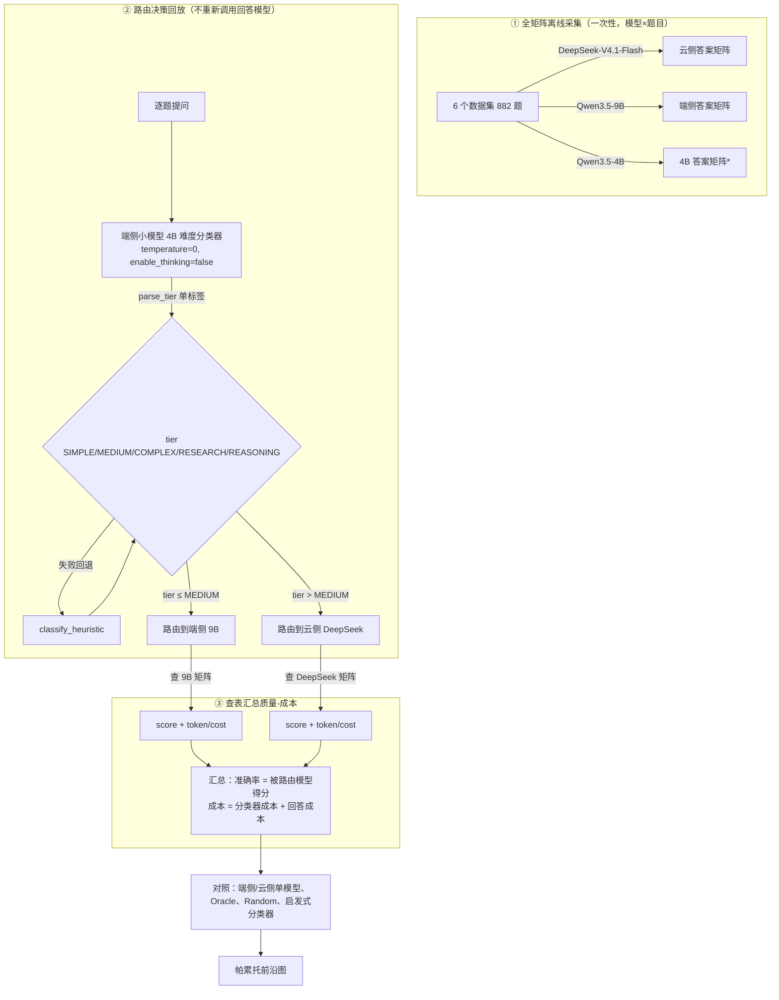

# XRouter 端侧路由 3 模型池离线回放评估报告（PC + 硅基流动真实 API）

## 1. 目标

在本机 PC 上用 LLMRouterBench 离线回放评估 MiniPC 端侧路由算法 **DeviceLLMRouter（= XRouter）**，
模型池按 XRouter 原生「三角色」语义扩为：

| 角色 | 模型 | 硅基流动 API 名 | 职责 |
|---|---|---|---|
| 端侧小模型（分类器） | Qwen3.5-4B | `Qwen/Qwen3.5-4B` | 先判断题目难易档位 |
| 端侧大模型（本地回答） | Qwen3.5-9B | `Qwen/Qwen3.5-9B` | 回答 SIMPLE/MEDIUM |
| 云侧模型（云端回答） | DeepSeek-V4.1-Flash | `deepseek-ai/DeepSeek-V4.1-Flash` | 回答 COMPLEX/RESEARCH/REASONING |

成本 / 质量均基于硅基流动**真实 API**（非模拟），逐题记录 token，成本可按价格表精确重算。

## 2. 三角色路由语义（忠实 XRouter 原生）

```
用户提问
  └─ classify()  → 端侧小模型 4B（LLM 分类器）
        │  buildClassifierPrompt(题目, 6000)  → PROMPT_TEMPLATE
        │  CloudClassifier: temperature=0, max_tokens=2048, enable_thinking=false
        │  parseTier() 严格单标签解析
        │  失败语义：调用失败→heuristic_fallback；解析失败→parse_failed
        │             （档位一律回退 classify_heuristic，故障只降不升）
        ├─ tier ≤ localCapabilityLevel(MEDIUM)  → 端侧 9B 回答
        └─ tier ∈ {COMPLEX, RESEARCH, REASONING} → 云侧 DeepSeek 回答
```

## 3. 方法

### 3.1 答案矩阵采集与对齐
- 既有矩阵（上一轮）：DeepSeek-V4.1-Flash 等 4 模型 × 6 数据集，共 **882 题**（gpqa/mmlupro/math500/arcc 各 150、gsm8k 100、mmlu 182）。
- 该 882 题是上一轮按**抽样数据**采的，而 `data/` 现已是全量数据集（gpqa 198、mmlu 14042…），直接跑官方 collector 会对齐不上且要采海量题。
- 因此写 [tools/collect_9b_882.py](../tools/collect_9b_882.py)：逐题复用旧 DeepSeek 记录的 `prompt/ground_truth/index`，调 9B 生成并按原判分器打分，产出与 DeepSeek 完全同 `(dataset, record_index)` 对齐的 9B 结果。

### 3.2 难度档位打标（4B 分类器）
- [tools/run_xrouter_classifier.py](../tools/run_xrouter_classifier.py) 对 882 题用 4B 分类器打档，复刻 CloudClassifier 请求（temperature=0、max_tokens=2048、enable_thinking=false）。
- 档位严格单标签；调用/解析失败回退启发式。产出 `results/xrouter_classifier_tiers.csv`。

### 3.3 质量-成本评估
- [tools/eval_device_llm_router_3model.py](../tools/eval_device_llm_router_3model.py) 离线回放：分类器档位 → 路由决策 → 查被路由回答模型的得分。
- 成本 = **分类器调用成本 + 回答模型成本**，均按 `token × 单价` 重算。
- [tools/eval_3model_sweep.py](../tools/eval_3model_sweep.py) 对 `localCapabilityLevel ∈ {SIMPLE, MEDIUM, COMPLEX, RESEARCH, REASONING, NONE}` 扫描出帕累托前沿。

### 3.4 计费单价（¥ / 百万 token，硅基流动真实价格，2026-10-28 查自 https://www.siliconflow.cn/pricing）
| 模型 | 输入 | 输出 | 说明 |
|---|---|---|---|
| Qwen3.5-4B（分类器） | 0 | 0 | **免费** |
| Qwen3.5-9B（端侧） | 1.50 | 12.00 | 输出 = 8× 输入 |
| DeepSeek-V4.1-Flash（云侧） | 2.00 | 8.00 | 0-2点/8-24点档（2-8点更低） |

> ⚠️ **关键事实**：端侧 9B 的**输出 token（¥12/M）比云侧 DeepSeek（¥8/M）贵 50%**，输入略便宜（1.5 vs 2.0）；
> 分类器 4B 免费。逐题 token 已落盘，单价变化可精确重算。此前 4B/9B 用了估算价（0.10/0.40、0.20/0.80），结论被显著高估「本地省钱」。

### 3.5 对照基线
端侧 only（9B）、云侧 only（DeepSeek）、Oracle（每题最优上界）、Random（0.5/0.5 期望）、
以及「**启发式分类器**」（同名模型池、同规则，仅把分类器换成 `classify_heuristic`，量化 4B 分类器相对启发式的增益）。

## 4. 结果

### 4.1 总览（6 数据集合并，成本含分类器调用）

| 方案 | 准确率 | 总成本 (¥) | n | 备注 |
|---|---|---|---|---|
| **X-Router（4B 分类器，MEDIUM）** | **57.82%** | **6.172** | 882 | 端侧 545 / 云侧 337 |
| X-Router（启发式分类器，MEDIUM） | 46.26% | 10.751 | 882 | 端侧 870 / 云侧 12 |
| 端侧 only（9B） | 45.92% | 10.867 | 882 | |
| 云侧 only（DeepSeek） | 82.20% | 4.743 | 882 | |
| Oracle（每题最优上界） | 88.55% | 5.317 | 882 | |
| Random（0.5/0.5 期望） | 64.06% | 7.805 | 882 | |

> ⚠️ 真实单价下的结论反转：**云侧 only（4.74 元 / 82.2%）在「更便宜且更准」两个维度都压过端侧 only（10.87 元 / 45.9%）**。
> X-Router 4B 分类器相对云侧 only：准确率 -24.4pp，成本**高出 30.1%**（6.17 vs 4.74）——即该模型池下「永远用云」帕累托支配 X-Router。

### 4.2 分类器档位 / source 分布

| source | 题数 | 占比 |
|---|---|---|
| llm（4B 成功打档） | 826 | 93.7% |
| heuristic_fallback（限流回退） | 56 | 6.3% |

档位分布（826 llm + 56 回退合并）：`SIMPLE:541, REASONING:297, RESEARCH:28, COMPLEX:12, MEDIUM:4`。

> 4B 分类器明显偏「REASONING」档（297/882），这是真实 LLM 分类器的行为；其效果是：对 gpqa/mmlupro 等难题更倾向甩云端。
> 因端侧 9B 比云侧更贵更弱，把难题甩云端反而「又省又准」（见 §5）。

### 4.3 分数据集（X-Router，4B 分类器，真实单价）

| dataset | n | 准确率 | 成本 (¥) | 端侧 | 云侧 |
|---|---|---|---|---|---|
| arcc | 150 | 43.33% | 0.442 | 138 | 12 |
| gpqa | 150 | 67.33% | 2.348 | 18 | 132 |
| gsm8k | 100 | 87.00% | 0.305 | 87 | 13 |
| math500 | 150 | 88.67% | 1.014 | 58 | 92 |
| mmlu | 182 | 30.77% | 0.642 | 151 | 31 |
| mmlupro | 150 | 45.33% | 1.421 | 93 | 57 |

### 4.4 帕累托图（真实单价）


（横轴 = 总成本 ¥，纵轴 = 准确率；蓝点 = 4B 分类器在 SIMPLE→NONE 档扫描，绿点 = 启发式分类器，
其余为单模型 / Oracle / Random。注意：端侧 only 落在最右（最贵），云侧 only 落在左上（既准又省）。）

### 4.5 分类分解图（Q1 启发式 / Q2 LLM / 对比）

**Q1 — 启发式分类**（把 882 题按词数/关键词/问号数分档）：


**Q2 — LLM 分类**（4B 打档 + 失败回退）：


**启发式 vs LLM vs 基线**（同一质量-成本平面）：


## 5. 结论与说明

1. **真实单价颠覆「本地省钱」前提**：端侧 9B 输出 ¥12/M **比云侧 DeepSeek ¥8/M 贵 50%**，且 9B 因「step-by-step」输出长、token 多，
   导致端侧 only 成本 **¥10.87 比云侧 only ¥4.74 贵 129%**，准确率还更低（45.92% vs 82.20%）。这个「本地模型」在质量与成本两个维度都劣于云侧模型。
2. **4B 分类器相对启发式有正收益（负成本差）**：4B 分类器把 337 道真难题路由到云侧，使总成本从启发式的 ¥10.75 降到 **¥6.17（-43%）**，
   准确率从 46.26% 升到 **57.82%（+11.6pp）**。原因是它把更多题甩给「更便宜且更准」的云侧，而不是留给昂贵的本地 9B。
3. **但 X-Router 仍被「永远用云」帕累托支配**：4B 分类器（57.82% / ¥6.17）相对云侧 only（82.20% / ¥4.74）仍是「更贵且更不准」。
   根因：模型池里唯一的本地回答模型 9B 既贵（¥12 输出）又弱（45.92%），本地侧没有「划算」的兜底选项。
4. **启发式分类器最差**：启发式按词数/关键词/问号数把 870/882 判成 SIMPLE/MEDIUM，几乎全留本地 → 46.26% / ¥10.75，等价于「全走本地」。
5. **成本口径修正**：4B 免费、9B 1.5/12（此前估算 0.1/0.4、0.2/0.8，严重低估 9B）；DeepSeek 2.0/8.0 与旧值一致。逐题 token 已落盘可重算。
6. **限流与回退**：56 题 LLM 分类失败（mmlupro 29 / mmlu 25 / gsm8k 2），原因硅基流动 4B 限流/慢速（单请求 60–95s），
   首轮 60s 超时 280 题、重试(120s/并发16)后仍 56 题超时——忠实 XRouter「失败只降不升」语义。

## 5.5 LLMRouterBench 如何评估路由算法（以 XRouter 为例）



> *4B 本轮角色是分类器，其「答案矩阵」不参与路由回答，仅 4B 单独对每道题打档（见 3.2）。

关键点：**路由算法本身只产出「每道题该走哪个模型」的决策；LLMRouterBench 用预先采好的「题目×模型」答案矩阵离线查表**，
把路由决策换算成质量（被路由模型的得分）与成本（分类器 + 回答模型的真实 token 计费），因此无需在评估时重复跑模型，
即可快速回放任意路由策略、扫描能力阈值、对比基线。

## 6. 复现命令

```bash
python tools/collect_9b_882.py                 # 采集 9B 答案矩阵
python tools/run_xrouter_classifier.py         # 4B 打难度档位
python tools/run_xrouter_classifier.py --retry-failed --concurrency 4   # 重试限流失败题
python tools/eval_device_llm_router_3model.py  # 评估（MEDIUM）
python tools/eval_3model_sweep.py              # 扫描 + 帕累托图
```