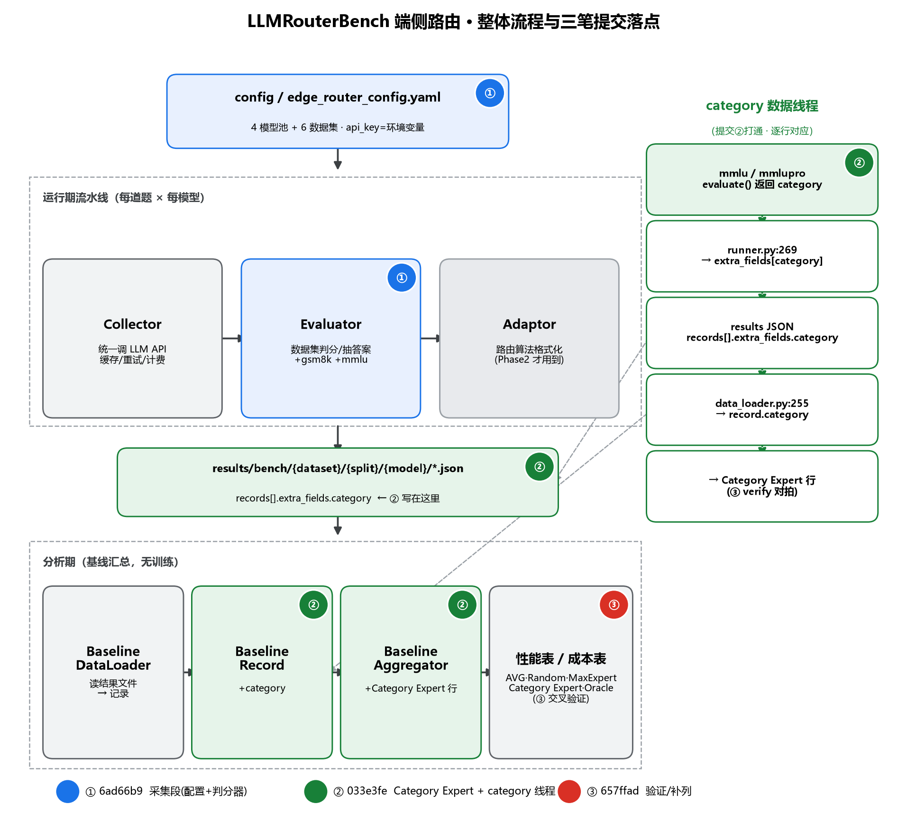
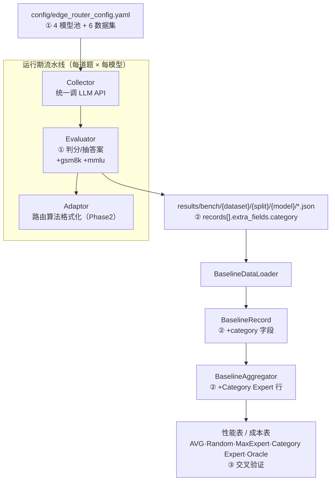

# LLMRouterBench 流程梳理 · 三笔提交的流程具象化

> 本文梳理 LLMRouterBench 的整体流程，并说明端侧扩展的三笔提交（`6ad66b9` → `033e3fe` → `657ffad`）各自的代码改动落在流水线的哪些环节。



---

## 0. 一句话定位三笔提交

| 提交 | 一句话定位 | 落在流水线哪一段 |
|---|---|---|
| **`6ad66b9`** | 接入端侧 4 模型 + 6 数据集，补 GSM8K/MMLU 判分器 | **「采集段」** 入口 + Evaluator |
| **`033e3fe`** | 新增 Category Expert（subject 粒度静态分表）基线 | **「分析段」** Schema / Loader / Aggregator + category 数据线程 |
| **`657ffad`** | 交叉验证脚本 + `columns` 补全 | **「分析段」** QA 收尾 |

---

## 1. 整体流程

LLMRouterBench 是「**Collector → Evaluator → Adaptor**」三段式 + 落盘 + 分析。



文本版（GitHub 外也能读）：

```
                         config/{edge_router_config}.yaml   ◀━【提交①新增】
                         4 模型池 + 6 数据集 + SiliconFlow API
                                      │
           python -m data_collector.cli run <config> -y
                                      ▼
┌──────────────────── 运行期流水线（每道题 × 每模型）────────────────────┐
│                                                                        │
│  [① Collector]          [② Evaluator]          [③ Adaptor]             │
│  data_collector/        evaluation/            baselines/adaptors/     │
│  统一调 LLM API  ─────▶ 数据集判分/抽答案 ────▶ 路由算法格式化          │
│                                      │                                 │
└──────────────────────────────────────┼─────────────────────────────────┘
                                       │ 落盘（标准化字段）
                                       ▼
   results/bench/{dataset}/{split}/{model}/*.json
   每条 record：origin_query · prompt · prediction · ground_truth
               · score · cost · extra_fields.category ◀━【提交②把 category 写进这里】
                                       │
         python tools/run_edge_analysis.py  ◀━【提交②新增入口】
                                       ▼
┌──────────────────── 分析期（基线汇总，无训练）────────────────────┐
│  BaselineDataLoader  →  BaselineRecord(+category)                 │
│  BaselineAggregator  →  性能表 / 成本表                            │
│  行：AVG · Random Router · Max Expert · Category Expert · Oracle   │
│                      ▲                                            │
│          Category Expert ◀━【提交②新增这一行】                     │
└────────────────────────────────────────────────────────────────────┘
```

> **关键点**：官方 Quick Start 三步 = 采集 + 分析 + **训练路由模型**。这三笔提交只涉及前两步，**未触碰 train 段**（train 是 Phase 2 学一个可部署路由模型时才需要的 `adaptor` 流程）。

---

## 2. 三笔提交各自的改动，落在流程的哪里

### 提交① `6ad66b9` — 让「采集」按端侧池子跑起来（12 文件 / +290）

只动了**输入配置 + Evaluator 判分器**，Collector 主框架未改。

| 环节 | 文件 | 改动 |
|---|---|---|
| 流程入口 | `config/edge_router_config.yaml` | 新增：4 模型(3×Qwen 免费 + DeepSeek-Flash)、6 数据集、SiliconFlow、pricing、`api_key=环境变量` |
| 流程入口 | `config/edge_router_config_demo.yaml` | demo 冒烟版（跑少量样本） |
| Evaluator | `evaluation/factory.py` | +8：注册 gsm8k、mmlu 进判分器工厂 |
| Evaluator | `evaluation/GSM8K/gsm8k.py` | 新增：GSM8K 判分（抽数字比对） |
| Evaluator | `evaluation/MMLU/mmlu.py` | 新增：MMLU 判分（抽字母比对） |
| Evaluator | `evaluation/base_evaluator.py` | +`encoding="utf-8"`（Windows GBK 兼容） |
| 数据源 | `data/GSM8K/test.json`、`data/MMLU/test.json` | 新增（LFS 指针） |
| 读取端 | `baselines/data_loader.py` | +`encoding="utf-8"` |
| 读取端 | `config/baseline_config_edge.yaml` | 新增：给分析段的加载配置 |

### 提交② `033e3fe` — 给「分析」加 subject 粒度基线（8 文件 / +286）

在「落盘字段 → 数据模型 → 汇总计算」这条分析链上打通 category 线程。

| 环节 | 文件 | 改动 |
|---|---|---|
| 产出端 | `evaluation/MMLU/mmlu.py`、`evaluation/MMLUPro/mmlupro.py` | `evaluate()` 返回值 +`category` |
| 数据模型 | `baselines/schema.py` | +5：`BaselineRecord` 加 `category` 字段 |
| 读取端 | `baselines/data_loader.py` | +5：从 `extra_fields.category` 解析 |
| 计算端 | `baselines/aggregators.py` | +163：`_category_expert_routing` + 性能/成本表 「Category Expert」 行 |
| 工具 | `tools/enrich_category.py` | 新增：存量结果按 `origin_query` 回填 category |
| 工具 | `tools/run_edge_analysis.py` | 新增：一键跑分析入口 |
| 杂项 | `.gitignore` | +`results/edge_*.csv` |

### 提交③ `657ffad` — 验证 + 补漏（2 文件 / +177）

| 环节 | 文件 | 改动 |
|---|---|---|
| 读取端 | `config/baseline_config_edge.yaml` | +2：`columns.include` 补 `category`、`origin_query` |
| QA | `tools/verify_category_expert.py` | 新增：独立交叉验证脚本（pandas 另算 → 对拍 aggregator） |

---

## 3. category 数据线程（提交②的核心）

`category` 从题目一路流到「Category Expert」行的精确路径：

```
① data/MMLU/test.json                       题目自带 category（如 psychology/history…）
      │  load_data() 一起读进来
      ▼
② mmlu.py / mmlupro.py  evaluate() 返回 dict 里含 "category"
      │  runner.py:269-270 —— 自动把 evaluate() 返回值里除
      │  is_correct/prediction/ground_truth 之外的所有字段收进 extra_fields
      ▼
③ RecordResult.extra_fields["category"]
      │  storage.py:99 —— 写进结果 JSON
      ▼
④ results/bench/mmlu/test/{model}/*.json → records[].extra_fields.category
      │  ⚠️ 存量结果这步为空 → tools/enrich_category.py 回填
      ▼
⑤ data_loader.py:255-256 —— extra_fields.get('category') → BaselineRecord.category
      │
      ▼
⑥ aggregators.py  _category_expert_routing：
      按 (dataset, category) 分组 → 每个 subject 挑均值分最高的模型建"分表"
      → 每题路由到它所在 subject 的最优模型（无 subject 退到数据集最优）
      ▼
⑦ 性能表/成本表的 "Category Expert" 行
   （Sample-Avg 82.88%，成本 ¥4.385；增益来自 MMLU-Pro 的 psychology 12 题→免费 4B）
```

**交叉验证闭环（提交③）**：`verify_category_expert.py` 用 pandas 走另一条代码路径，从 ⑤ 的 `BaselineRecord` 重算 ⑦，再与 ⑥ 的输出逐列对拍 → 6/6 数据集一致、样本级 82.8798% 一致。

---

## 4. 串起来的一句话

> **提交①** 把「输入(配置) + 判分(Evaluator) + 数据」补齐，让采集段能产出 4×6 的结果；**提交②** 在「结果→记录→汇总」的分析链上打通 `category` 线程、新增 subject 粒度静态分表这行；**提交③** 用独立算法复核该行 + 补列声明。三笔提交全程只动「采集 / 分析」，未触碰「train」段。